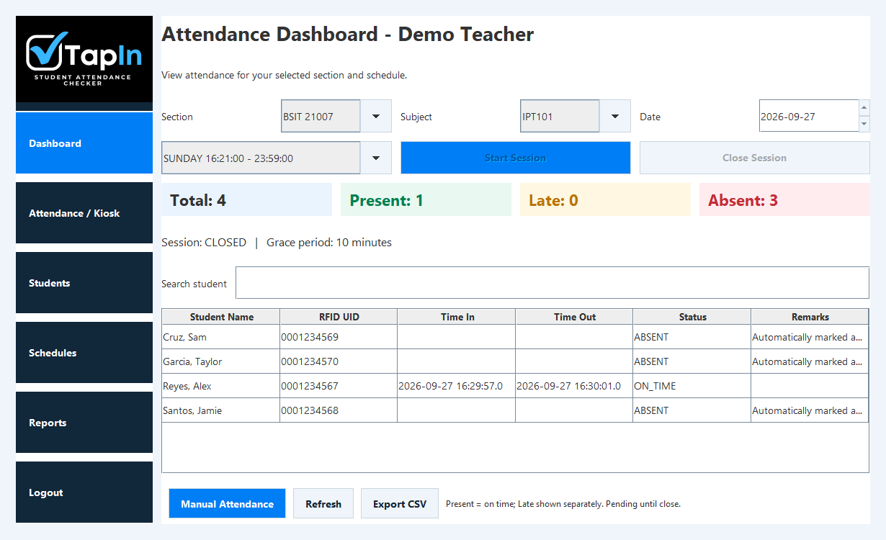

# TapIn — Student Attendance Checker

TapIn is a Java desktop attendance system for staff and teachers. It uses RFID readers that behave as keyboard input, with a typed UID option for demonstration. This preserves the Java/NetBeans, MySQL, and RFID purpose described in the original repository placeholder.

## Technologies

Java 17, Swing, editable NetBeans JFrame Forms, JDBC, MySQL/MariaDB, and MySQL Connector/J. The driver and its existing license are included under `lib/`; the matching vendor source and build scripts are retained under `third_party/`.

## Implemented features

- Staff login and administrator/teacher roles
- Student, teacher, section, subject, and schedule management
- Attendance sessions, RFID time-in/time-out, late/absent status, and manual correction
- Reports and CSV export
- Explicit one-time administrator or demo-data setup

## Development status

This is an educational local desktop application. The current implementation stores account passwords as plain text in its database, as recorded by the existing project documentation. It is not suitable for storing production account passwords without a separate security redesign. Repository preparation preserves that behavior.

The optional demo initializer contains deliberately public sample credentials and fictional students; these are not private account exports. Real database configuration, school timetable data, and local database contents are excluded. Existing development reports describe earlier desktop checks; no new GUI, database, printer, or RFID hardware test was performed for this upload.

## Build and run on Windows

1. Install JDK 17 and a local MySQL/MariaDB server, such as XAMPP's MariaDB.
2. Copy `config/database.properties.example` to `config/database.properties`, then enter your own connection settings. Keep the local file out of Git.
3. For a new installation, import `sql/setup.sql` once. It creates `tapin_rebuild`; do not import it over an existing installation.
4. Open the repository folder as a NetBeans project, or build from PowerShell:

```powershell
powershell -NoProfile -ExecutionPolicy Bypass -File .\build.ps1
```

5. Initialize a new administrator interactively from the project root:

```powershell
java -cp "dist/TapIn.jar;lib/*" tapin.Setup --admin
```

For isolated demonstration data instead, use `tapin.Setup --demo`. Both initializers refuse an existing account set. Demo credentials are defined in `src/tapin/Setup.java`; replace them before using real data.

6. Launch `run.bat` or run `java -jar dist/TapIn.jar` from the project root. The app reads its configuration relative to the working folder. Keep `config/`, `lib/`, and the generated `dist/` files together when installing locally.

For an existing older installation, consult `sql/migrate_plain_passwords.sql` and the original development records before any database migration. This source upload does not run a migration.

## Existing tests

`test.ps1` runs the existing integration checks against your explicitly configured local database and creates isolated test schemas. Read the script before running it; it requires database-creation permission. No tests that write a database were run during repository preparation.

## Real application capture

The following retained screenshot shows the actual Swing application with the fictional students created by `Setup --demo`; it is a development capture, not a current device test.



## Structure

- `src/`: application code and image resources
- `nbproject/`: editable NetBeans project metadata
- `sql/`: schema and existing migration
- `lib/`: required JDBC driver and its license
- `config/database.properties.example`: connection template
- `test/` and `docs/`: existing checks and architecture records

## Repository preparation

This repository contains the existing local implementation. Application source and build logic are preserved. Generated output, signing keys, credentials, and local service configuration are excluded. Earlier development reports describe their original checks; repository preparation did not repeat an application build or device test.
